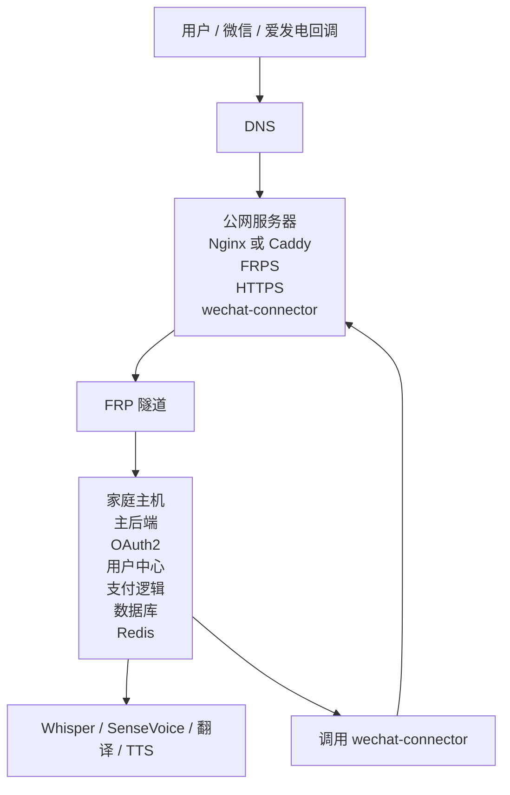

# 公网服务器 + FRP + Nginx 部署拓扑说明

## 1. 目标

本部署方案用于解决以下现实约束：

- 家庭主机拥有主要业务和算力
- 家庭公网 IP 动态变化
- 微信、公众号、支付回调需要稳定公网入口
- 公网服务器性能较弱
- 不希望把数据库、计算服务、大型 Docker 迁到公网服务器

核心思路：

- 公网服务器只做稳定入口
- 家庭主机继续承担主业务和主算力

---

## 2. 总体拓扑



---

## 3. 角色分工

## 3.1 公网服务器

建议只承载：

- `frps`
- `nginx` 或 `caddy`
- TLS 证书
- 域名入口
- `wechat-connector`
- 可选静态官网页面
- 可选极轻量 webhook 缓冲或转发

明确不建议承载：

- Whisper
- SenseVoice
- 翻译服务
- 主数据库
- Redis 主实例
- 主业务后端

## 3.2 家庭主机

建议承载：

- FastAPI 主业务
- OAuth2 身份中心
- 官网用户中心后端
- 爱发电业务逻辑
- MySQL/PostgreSQL
- Redis
- Whisper / SenseVoice / TTS / 翻译服务

---

## 4. 域名规划

建议规划：

| 域名 | 作用 |
| --- | --- |
| `www.example.com` | 官网展示页 |
| `account.example.com` | 登录、注册、OAuth2、用户中心 |
| `api.example.com` | 客户端 API / 资源服务 |
| `admin.example.com` | 管理后台 |
| `pay.example.com` | 支付相关入口，可选 |

说明：

- 实际上也可以都经由同一个入口反向代理。
- 但从安全和后期维护角度，建议域名分开。

---

## 5. 推荐端口规划

家庭主机示例：

| 服务 | 监听 |
| --- | --- |
| 主应用网关 | `127.0.0.1:9000` |
| OAuth2 / Portal 后端 | `127.0.0.1:9001` |
| API 资源服务 | `127.0.0.1:9002` |
| 管理后台 | `127.0.0.1:9003` |
| Whisper | `127.0.0.1:8000` |
| SenseVoice | `127.0.0.1:8800` |
| Redis | `127.0.0.1:6379` |
| MySQL/PostgreSQL | 内网监听 |

公网服务器示例：

| 服务 | 监听 |
| --- | --- |
| Nginx/Caddy | `80/443` |
| FRPS | `7000` |
| FRPS Dashboard | 可选 |

---

## 6. FRP 设计

## 6.1 推荐方式

建议家庭主机通过 `frpc` 主动连接公网服务器 `frps`。

这样可以解决：

- 家庭公网 IP 动态变化
- NAT 环境无法被动接入

## 6.2 推荐暴露方式

优先建议：

- 只暴露家庭主机上的 HTTP 网关端口

不建议：

- 分别暴露数据库
- 分别暴露 Whisper 端口
- 直接公网暴露 Redis

推荐结构：

```text
公网服务器 443
  -> Nginx
  -> 反代到 FRP 暴露的家庭主机 HTTP 网关
  -> 家庭网关再按 Host 分发到 account/api/admin
```

也可以由 FRP 直接映射多个子域，但从可控性看，Nginx 统一收口更稳。

重要说明：

- FRP 只解决“外部如何稳定访问你”
- FRP 默认不解决“你访问微信时的固定出口 IP”
- 因此微信 API 调用不能依赖家庭主机直连

## 6.3 微信连接器方案

由于微信服务端接口通常受开发者 IP 白名单限制，建议采用专用连接器方案：

- 在公网服务器上部署轻量 `wechat-connector`
- 家庭主机不直接调用 `api.weixin.qq.com`
- 家庭主机统一调用公网服务器上的连接器
- 连接器再使用公网服务器固定 IP 调用微信官方接口

推荐职责：

- 换取网页授权 token
- 获取微信用户资料
- 获取/缓存公众号 access token
- 获取/缓存 JSAPI ticket
- 调用菜单、模板消息等公众号管理接口

不建议：

- 把整个主业务搬到公网服务器
- 对公网开放一个通用 HTTP 代理
- 让家里主机直接访问微信生产接口

---

## 7. 推荐反向代理结构

## 7.1 公网服务器 Nginx

职责：

- TLS 终止
- Host 路由
- 安全头
- 请求大小控制
- 基础限流
- Webhook 入口稳定化

示意：

```nginx
server {
    listen 443 ssl http2;
    server_name account.example.com;

    ssl_certificate /etc/letsencrypt/live/example/fullchain.pem;
    ssl_certificate_key /etc/letsencrypt/live/example/privkey.pem;

    location / {
        proxy_pass http://127.0.0.1:18080;
        proxy_set_header Host $host;
        proxy_set_header X-Real-IP $remote_addr;
        proxy_set_header X-Forwarded-For $proxy_add_x_forwarded_for;
        proxy_set_header X-Forwarded-Proto https;
    }
}
```

说明：

- `127.0.0.1:18080` 可以是 FRP 暴露的本地端口。

## 7.2 家庭主机网关

家庭主机可再加一层本地 Nginx 或直接由应用网关分发。

Host 分发示例：

- `account.example.com` -> `127.0.0.1:9001`
- `api.example.com` -> `127.0.0.1:9002`
- `admin.example.com` -> `127.0.0.1:9003`

---

## 8. 官网部署建议

## 8.1 推荐方案 A

- 官网静态页放公网服务器
- 用户中心和 API 反代到家庭主机

优点：

- 首屏更稳定
- SEO 更好
- 公网服务器负载极低

## 8.2 方案 B

- 官网、用户中心、API 全都在家庭主机
- 公网服务器只做 HTTPS 反代

优点：

- 维护简单

缺点：

- 对家庭网络依赖更强

结论：

- 优先推荐方案 A

---

## 9. 微信与支付回调路径

## 9.1 微信

推荐将微信授权回调地址配置为：

- `https://account.example.com/auth/wechat/callback`

公网服务器接收后：

- 原样反代到家庭主机身份中心

但要注意：

- 回调成功后，身份中心服务端仍需要请求微信接口用 `code` 换取 token/openid
- 这一步应通过 `wechat-connector` 完成
- 微信公众平台开发者 IP 白名单应配置为公网服务器固定 IP

## 9.2 爱发电 Webhook

推荐将 Webhook 路径配置为：

- `https://pay.example.com/api/user-center/afdian/webhook`

或统一：

- `https://account.example.com/billing/afdian/webhook`

建议：

- Webhook 路径独立
- Nginx 层限制请求方法和 body 大小
- 应用层做签名/来源校验和幂等处理

---

## 10. 安全建议

## 10.1 公网服务器

- 禁止直接暴露数据库端口
- 禁止直接暴露 Redis
- 禁止直接暴露 Whisper / SenseVoice
- 只开放 `80/443` 和 `frps` 必要端口
- 强制 HTTPS

## 10.2 家庭主机

- 所有内部服务监听 `127.0.0.1` 或内网
- 只让网关服务对 FRP 映射端口可见
- 数据库做定期备份
- 所有敏感环境变量单独管理

## 10.3 FRP

- 使用 token 鉴权
- 限制允许的代理配置
- 不使用通配泛暴露

---

## 11. 可用性建议

由于家庭主机仍是主站，必须接受以下事实：

- 家庭断网时，官网动态功能不可用
- 公网服务器在线不代表主业务在线

因此建议补充：

- 公网服务器放健康检查页
- 官网静态页可降级展示“服务维护中”
- Webhook 支持重试与后台补单
- 定期异地备份数据库

---

## 12. 资源分布建议

### 必须放家庭主机

- 主业务后端
- 身份中心
- MySQL/PostgreSQL
- Redis
- Whisper
- SenseVoice
- 翻译服务

### 建议放公网服务器

- Nginx / Caddy
- FRPS
- wechat-connector
- 静态官网
- 证书

### 可选放公网服务器

- 轻量消息中继
- 极简状态页

---

## 13. 推荐切换顺序

### 第一步

- 先搭公网服务器入口
- 配好域名和 HTTPS
- 先不切生产业务

### 第二步

- FRP 打通家庭主机测试环境
- 校验回源头与 X-Forwarded-* 头

### 第三步

- 先切官网静态页

### 第四步

- 切 `account.example.com`
- 切 OAuth2 与用户中心

### 第五步

- 切 `api.example.com`
- 客户端逐步迁移

### 第六步

- 切微信回调与支付回调

---

## 14. 风险点

高风险点：

- 家庭网络波动导致登录或支付回调偶发失败
- 公网服务器和家庭主机的时间偏差影响 token 与签名
- HTTPS 回源配置错误导致微信回调失败
- 客户端 API 与官网回源路径混用导致路由混乱

建议：

- 所有机器同步 NTP
- 先用测试域名和测试应用打通
- 回调路径独立，不和普通 API 混用
- 记录完整请求 ID 和反代日志

---

## 15. 结论

这套部署方案的核心是：

1. 静态公网 IP 只承担“入口”
2. 微信 API 固定出口也放在公网服务器上的 `wechat-connector`
3. 主业务和主算力继续放在家里
4. 通过 FRP + 反向代理实现稳定对外域名

这样既满足微信和支付回调的稳定入口要求，也解决了微信开发者 IP 白名单问题，同时不需要把重型服务迁到性能差的公网服务器。
