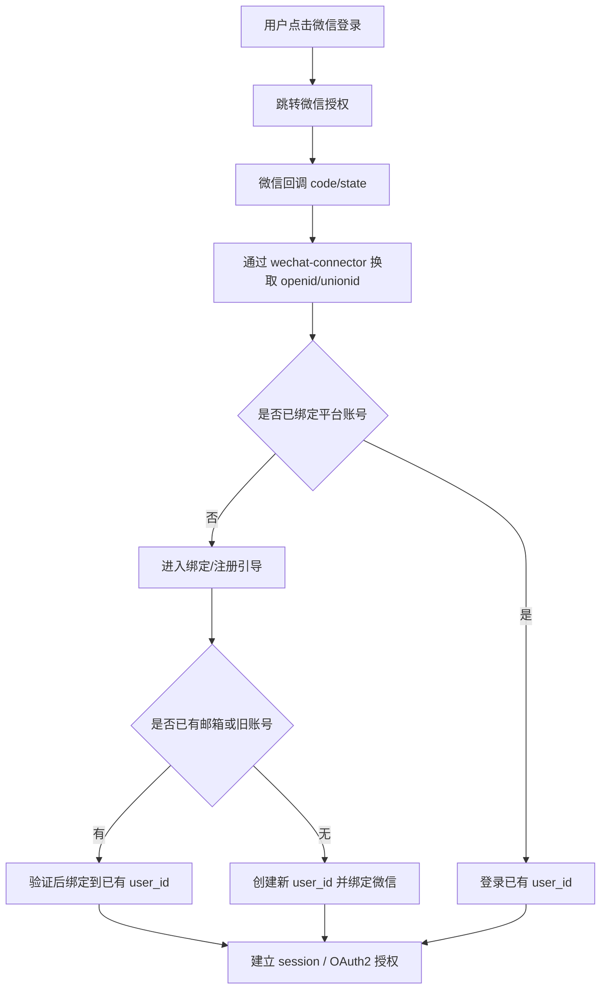

# 微信登录与账号绑定流程设计稿

> 当前版本不实施微信登录。本文件仅作为未来备选方案保留，不纳入当前开发范围。

## 1. 目标

本设计用于支持：

- 微信公众号网页登录
- 微信身份与平台账号绑定
- 微信用户与邮箱用户合并为同一平台账号
- 后续用户中心、支付、OAuth2 使用统一 `user_id`

原则：

- 微信不是独立账号体系
- 微信只是平台账号的一种登录身份
- 内部统一主身份始终是 `user_id`

---

## 2. 场景定义

需要覆盖 4 类场景：

### 场景 A

- 新用户首次使用微信登录
- 系统中不存在对应账号

结果：

- 引导创建新平台账号
- 绑定微信身份
- 建立站内 session

### 场景 B

- 老用户已存在邮箱账号
- 现在希望用微信登录

结果：

- 绑定微信身份到已有 `user_id`
- 后续支持微信直接登录

### 场景 C

- 用户先用微信登录创建账号
- 之后补充邮箱密码

结果：

- 同一 `user_id` 增加邮箱凭据

### 场景 D

- 历史旧客户端用户名密码账号
- 后续希望绑定微信并迁移到新官网

结果：

- 微信身份绑定到历史账号对应的 `user_id`
- 后续逐步去除旧用户名登录依赖

## 2.1 微信 IP 白名单前提

微信公众号服务端接口通常受开发者 IP 白名单限制。

这里要区分两类流量：

- 微信访问你的网站回调：主要依赖公网域名与 HTTPS
- 你的服务端访问微信接口：受微信开发者 IP 白名单限制

因此本方案默认前提为：

- 家庭主机不直接访问微信官方 API
- 所有微信 API 请求统一通过部署在公网服务器上的 `wechat-connector`
- 微信公众平台的开发者 IP 白名单配置为公网服务器固定 IP

---

## 3. 微信身份模型

建议使用 `user_identities` 表保存微信信息。

关键字段：

- `provider = wechat_official_account`
- `provider_app_id`
- `openid`
- `unionid`
- `nickname`
- `avatar_url`

识别优先级：

1. 优先 `unionid`
2. 无 `unionid` 时，用 `provider_app_id + openid`

禁止：

- 以昵称作为绑定依据
- 允许同一个微信身份绑定多个平台账号

---

## 4. 总体流程



---

## 5. 详细流程设计

## 5.1 发起登录

接口建议：

- `GET /auth/wechat/start`

输入：

- `return_to`
- `bind_mode`

行为：

1. 服务端生成一次性 `state`
2. 记录上下文：
   - 来源页
   - 是否为绑定流程
   - 当前会话用户
3. 302 跳转微信授权页

## 5.2 微信回调

接口建议：

- `GET /auth/wechat/callback`

输入：

- `code`
- `state`

服务端处理：

1. 校验 `state`
2. 通过 `wechat-connector` 用 `code` 向微信换取身份信息
3. 提取：
   - `openid`
   - `unionid`
   - `nickname`
   - `headimgurl`
4. 查找 `user_identities`

可能结果：

- 已绑定：直接登录
- 未绑定：进入绑定引导

---

## 6. 已绑定用户登录

当微信身份已绑定时：

1. 通过 `user_identities` 找到 `user_id`
2. 校验 `users.status`
3. 更新 `last_login_at`
4. 建立站内 session
5. 如处于 OAuth2 流程，则继续授权码流程

返回结果：

- 浏览器跳转到用户中心
- 或跳转回 OAuth2 `redirect_uri`

---

## 7. 未绑定用户处理

## 7.1 用户未登录，且系统中无现有账号

引导页可提供两种路径：

1. 直接创建新账号
2. 绑定已有账号

### 直接创建新账号

建议流程：

1. 使用微信身份创建 `users`
2. `display_name` 初值可取微信昵称
3. 写入 `user_identities`
4. 要求补充邮箱，或允许稍后补充
5. 建立 session

注意：

- 不建议只靠微信而永远没有第二登录方式
- 最好尽快引导补邮箱

## 7.2 用户未登录，但系统中已有邮箱或历史账号

引导用户执行“绑定已有账号”：

1. 输入邮箱密码或旧用户名密码
2. 登录验证成功
3. 将当前微信身份绑定到该 `user_id`
4. 建立 session

---

## 8. 已登录用户绑定微信

适用于用户已经登录官网，然后从“账号绑定页”绑定微信。

流程：

1. 用户在账号设置页点击“绑定微信”
2. 跳转微信授权
3. 微信回调
4. 服务端确认当前 session 用户
5. 检查该微信身份是否已被其他账号绑定
6. 未被占用则写入 `user_identities`

异常处理：

- 若该微信已绑定其他账号，禁止绑定并提示冲突

---

## 9. 冲突与合并策略

## 9.1 微信已绑定其他账号

处理规则：

- 直接拒绝绑定
- 不自动覆盖
- 由用户走申诉或人工处理

原因：

- 自动转绑风险极高

## 9.2 用户已经有微信账号，又尝试绑定邮箱账号

如果当前登录用户是微信创建账号，后续补邮箱：

- 直接在同一 `user_id` 下新增 `user_credentials`

## 9.3 旧账号迁移

如果用户已有历史用户名账号，希望绑定微信：

1. 先用旧凭据登录
2. 绑定微信
3. 后续再补邮箱

不建议：

- 在未验证旧账号控制权的情况下直接合并

---

## 10. 推荐页面与状态流

## 10.1 页面建议

建议至少准备这些页面：

- 微信登录跳转页
- 微信绑定结果页
- 绑定已有账号页
- 补充邮箱页
- 绑定冲突提示页

## 10.2 页面状态

建议 UI 状态：

- `wechat_bound`
- `wechat_unbound`
- `wechat_binding_conflict`
- `email_missing`
- `binding_success`

---

## 11. 接口建议

### `GET /auth/wechat/start`

用途：

- 发起授权

### `GET /auth/wechat/callback`

用途：

- 微信回调

说明：

- 该接口本身运行在家庭主机身份中心
- 但其中涉及的微信官方 API 调用全部通过 `wechat-connector` 完成

### `POST /auth/wechat/bind-existing-account`

用途：

- 用邮箱或历史账号验证后完成绑定

请求：

```json
{
  "login": "user@example.com",
  "password": "******",
  "wechat_binding_token": "wb_123"
}
```

### `POST /auth/wechat/create-account`

用途：

- 用当前微信身份创建新账号

请求：

```json
{
  "display_name": "demo",
  "email": "user@example.com"
}
```

### `POST /auth/wechat/unbind`

用途：

- 解绑当前账号的微信身份

限制：

- 至少保留一种其他可登录方式

---

## 12. 安全与风控建议

### 12.1 state 校验

- 微信回调必须校验服务端保存的 `state`
- `state` 必须一次性消费

### 12.2 绑定令牌

当用户进入“绑定已有账号”流程时，建议生成短期绑定令牌：

- `wechat_binding_token`
- 有效期短
- 一次性使用

### 12.3 关键日志

建议记录：

- 微信登录成功
- 微信绑定成功
- 微信绑定冲突
- 微信解绑
- 绑定已有账号失败

### 12.4 解绑限制

不允许出现以下状态：

- 用户没有邮箱密码
- 用户也没有其他第三方身份
- 然后还解绑唯一微信身份

否则该账号将无法登录。

### 12.5 wechat-connector 调用约束

- 身份中心到 `wechat-connector` 必须使用内部鉴权
- 不允许把 `wechat-connector` 做成任意 URL 转发器
- 建议仅暴露固定白名单接口：
  - code 换 token
  - 获取用户资料
  - 获取 access token
  - 获取 JSAPI ticket

---

## 13. 与支付和用户中心的关系

微信登录接入后，支付与用户中心必须使用同一 `user_id`。

这意味着：

- 爱发电支付必须从当前登录用户发起
- 微信登录用户支付时不需要用户名密码
- 订单、订阅、加油包都挂在 `user_id`

这是本轮重构必须统一的关键点。

---

## 14. 实施建议

### 第一阶段

- 支持微信登录回调
- 支持已绑定账号直接登录
- 支持登录后绑定微信

### 第二阶段

- 支持微信创建新账号
- 支持微信账号补邮箱

### 第三阶段

- 支持更完善的账号合并与冲突处理
- 后台支持查看绑定关系与人工处理

---

## 15. 结论

微信登录的本质不是“新增一个登录按钮”，而是把微信身份接入统一账号体系。

只要始终坚持：

1. 主身份是 `user_id`
2. 微信只是登录方式
3. 绑定关系有唯一约束
4. 支付和资产只认 `user_id`
5. 微信官方 API 统一走固定公网 IP 的 `wechat-connector`

那么官网、用户中心、支付和 OAuth2 都能保持一致。
